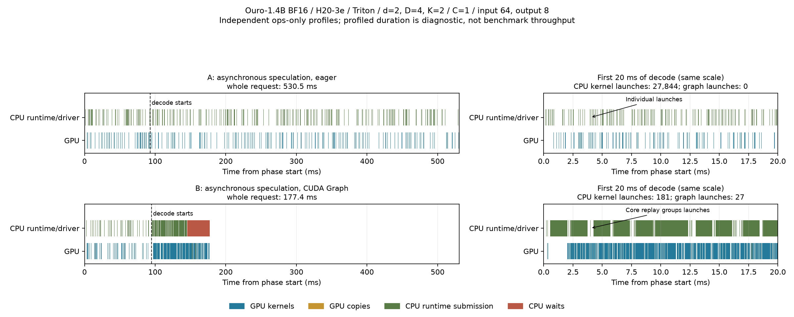
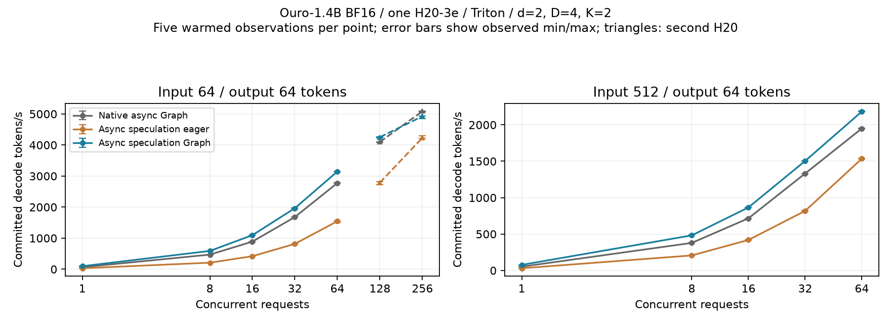

# Cross-round asynchronous self-speculation

This opt-in path uses fixed-depth Ouro, `last_exited` KV, greedy sampling,
Triton attention, eager or CUDA Graph execution, and refill scheduling. Historical tests used H20;
FlashAttention is not required. Draft depth is configurable, with `d=2, D=4`
as the initial validation configuration. The target depth must match the model.

```python
from vllm_rlt import LLM, ExecutionConfig, SamplingParams, SpeculativeConfig

llm = LLM(
    "artifacts/models/Ouro-1.4B",
    device="cuda",
    attention_backend="triton",
    execution_config=ExecutionConfig(async_scheduling=True),
    speculative_config=SpeculativeConfig(num_speculative_tokens=2),
)
outputs = llm.generate(
    ["Explain speculative decoding."],
    SamplingParams(temperature=0, max_loops=4, exit_threshold=1.0, max_tokens=64),
)
```

The CLI combines `--async-scheduling --attention-backend triton
--speculative-tokens 2 --draft-loops 2 --target-loops 4 --temperature 0`.
Random sampling, adaptive exit, preemption and PD are rejected.
The speculative runner owns its compute and result-copy streams. Setting
`multi_stream=False` orders the copy on the compute stream as well; cross-round
CPU/GPU submission remains asynchronous, but D2H no longer overlaps computation.

## CUDA Graph execution

Enable core and LM-head graphs with
`ExecutionConfig(async_scheduling=True, cuda_graphs=True)`, or add
`--cuda-graphs` to the CLI above. Fixed draft/target depths and the configured
maximum K remain unchanged. Output, context and scheduler limits can still
shorten a round, including effective K=0.

The speculative core uses device-owned positions and allocation-identity checks;
it does not populate CPU `written` metadata or read back a position to select a
graph. Graph inputs have stable addresses. Active page tables are still uploaded
once per round, then copied into graph-owned metadata for each core replay.
The LM head also uses graphs; prelude, metadata construction, argmax,
acceptance/state updates and result copies remain outside capture.

The asynchronous speculative core and Ouro LM-head use a fixed geometric set
of row buckets. Starting at `cuda_graph_max_batch_size`, repeatedly halve
(rounding up) until reaching one row or `cuda_graph_max_graphs` sizes. With the
defaults, the sizes are 1, 2, 4, 8, 16, 32, 64, 128. Smaller calls replay the
smallest fitting bucket and return only the active output rows. A lower entry
limit coarsens this fixed set rather than admitting arbitrary shapes until full;
for example, 17 rows with three entries gives buckets 5, 9, 17.

Padding receives zero hidden states and zero context lengths. A device-resident
active-row count guards KV scatter in the captured kernel: inactive rows do not
load write addresses or write any KV, including during capture. Real positions,
allocation checks, and per-depth block tables retain the same ownership. The
Ouro head is row-independent; Huginn coda and synchronous/native core graphs
retain their existing exact-shape behavior.

All speculative buckets are warmed and captured during engine construction,
before serving requests, with zero active core rows. No speculative capture or
cache-capacity fallback occurs for a new row count within the limit. Startup
capture time and memory are costs of enabling this path; coarser buckets also
add padded GPU work. Native bootstrap still uses its existing lazy exact-shape
cache, so this is not a claim that all engine paths avoid cold capture.

`cuda_graph_max_batch_size` bounds token rows, not requests: eight requests with
K=4 need 40 verification rows. With the default 128-row limit, full verification
stops fitting at concurrency 43 for K=2, or 26 for K=4; above 128 requests even
drafting cannot fit. Those over-limit calls still run eager. Startup warns when
`max_num_seqs * (K + 1)` exceeds coverage; raise the limit explicitly and budget
the additional capture memory if necessary.

Graph outputs are sliced to active rows and cloned before another replay can
reuse shared-pool storage. The two result buffers retain copy-completion and
cancellation ordering. Tests cover shrinking/reusing buckets, untouched KV for
inactive rows, and greedy token equality against eager. Padding changes GEMM
shapes, so these tests do not establish bitwise logits or universal greedy
invariance for every model and input.

Automatic KV planning treats `cuda_graph_memory_reserve_bytes` as headroom per
graph pool, and additionally reserves retained speculative coda logits across
the configured entries and row capacity. Ouro asynchronous speculation owns
three pools (native core, speculative core/coda); its default pool headroom is
therefore 3 GiB before the retained-logits allowance. Native Ouro has one pool;
Huginn has native core/coda pools and cannot speculate. These are conservative
planning allowances, not a guarantee against capture OOM for every model.
Explicit `num_blocks` or `kv_cache_memory_bytes` bypass automatic planning;
leave graph memory available when choosing them. Record actual allocated/reserved
peaks. Enabling graphs does not establish a throughput
improvement; compare matched warmed eager/Graph runs and retain capture, replay
and fallback counts from `speculative_runner.graphs` and `coda_graphs`.

The H20 measurements below were collected at runtime `08d3f99`; the external
H100 measurements were collected at `9eb01bb`. Both predate the bucketed path
and its startup pre-capture policy. Their throughput values must not be presented
as measurements of the new implementation. Compare end-to-end completion as
well as decode/window throughput: short-output H100 bursts regress against
native async Graph, while tested longer sequences show 1.05–1.20× gains.

### Bucketed-path validation (2026-10-16)

The bucketed implementation passes 165 tests with 13 FlashAttention selectors
deselected and no skips on a two-H20 Slurm allocation (job 376). This includes
FP32/BF16 KV sentinels during zero-active warmup/capture, shrinking bucket reuse,
new counts after every bucket is populated, stale allocations, failure cleanup,
K=2/4 ragged arrivals, non-default device and two live engines. With identical
padded inputs, core outputs and logits are bitwise equal to eager computation;
the frozen tiny-model cases also preserve unpadded eager token IDs. Full
pre-commit (Ruff lint/format and CPU regression) passes.

A separate H20 BF16 diagnostic uses Ouro-1.4B `574fa66c`, torch 2.14.1+cu130 /
Triton 3.8.0, 32 distinct topic prompts clipped/repeated to 32–128 input tokens,
24–44 output limits, natural EOS enabled on half, 16 concurrent slots, a
512-token budget, 128 graph rows and 16 entries. Eight requests arrive at each
of steps 0/12/24/36. One warm workload precedes three unprofiled observations
per arm and K, with explicit identical KV capacity. It deliberately synchronizes
the speculative runner at each step to fix batch composition; it is a controlled
correctness/coverage diagnostic, **not a production-arrival latency or throughput
qualification**. Arms ran sequentially, not interleaved.

| K | Implementation | Core replay / fallback per trial | Coda replay / fallback per trial | New speculative captures per trial |
| ---: | --- | --- | --- | ---: |
| 2 | Exact rows (`73cfe4e`) | 150 / 136 | 55 / 52 | 0 |
| 2 | Bucketed | 286 / 0 | 107 / 0 | 0 |
| 4 | Exact rows (`73cfe4e`) | 254 / 80 | 104 / 35 | 0 |
| 4 | Bucketed | 334 / 0 | 139 / 0 | 0 |

The counts repeat in all three observations. **Bucketed Graph and eager with
the same padded computation agree for 32/32 requests at K=2 and K=4 in all
three trials. Against the original unpadded eager, only 29/32 agree at each K**;
the differing continuations are reproduced by padded eager with graph replay
replaced by ordinary model calls. Thus this validates replay of padded
computation, not universal bitwise equivalence to unpadded execution. First
unpadded-eager divergences are at output indices 10/26/35 (K=2) and 18/26/33
(K=4). No end-to-end task-accuracy qualification is inferred from this check.

A warmed complete-round ops-only/full pair for exact-row and bucketed paths
retains shapes, CPU/GPU stacks and memory timelines. Individual CPU kernel
submissions drop from 7,266 to 185, with Graph launches increasing from 3 to 11;
the bucketed trace contains the masked KV scatter kernel. Full capture exports
are nonempty. These instrumented windows diagnose cache coverage and submission,
not unprofiled speed or an end-to-end native-relative gain. Broader asynchronous
arrival performance and H100 testing of the bucketed implementation remain open.

#### First-divergence investigation (2026-10-16)

The 29/32 unpadded-eager agreement was investigated at frozen runtime
`dfbb0f7` on one H20-3e, torch 2.14.1+cu130 / Triton 3.8.0, with the same BF16
Ouro-1.4B checkpoint, inputs and controlled arrival/collection boundaries as
above. Six traced generations (unpadded eager, bucketed Graph, padded eager at
K=2/4; job 377) reproduced every frozen output exactly. Each first-divergence
comparison below has the **same complete prompt and generated prefix**, and
uses a verification row actually committed by acceptance, not a rejected draft
continuation. Indices are zero-based. These are correctness diagnostics, not
performance measurements.

| K | Request | First output index | Unpadded → padded token ID | Unpadded / padded top-two gap | Max absolute logit delta | Logit RMS delta |
| ---: | ---: | ---: | --- | --- | ---: | ---: |
| 2 | 21 | 26 | 32 → 37 | 0.0000 / 0.1250 | 0.156250 | 0.034166 |
| 2 | 22 | 10 | 8102 → 3982 | 0.0625 / 0.0000 | 0.125000 | 0.030789 |
| 2 | 28 | 35 | 3159 → 4869 | 0.0000 / 0.1250 | 0.203125 | 0.045824 |
| 4 | 15 | 33 | 314 → 2390 | 0.0000 / 0.1250 | 0.189697 | 0.036859 |
| 4 | 21 | 26 | 32 → 37 | 0.0000 / 0.1250 | 0.125000 | 0.032840 |
| 4 | 28 | 18 | 46816 → 27871 | 0.0625 / 0.0000 | 0.125000 | 0.023880 |

For example, K=2/request 22/index 10 compares token 8102 at 16.0000 versus
3982 at 15.9375 in unpadded eager. Padding makes both 16.0000, so `argmax`
selects the lower token index 3982. K=4/request 15/index 33 compares 314 and
2390 tied at 23.5000 in unpadded eager, versus 23.5000/23.6250 with padding.
The first actual output divergence occurs at arrival-loop step 59 for K=2
(request 22), and step 34 for K=4 (request 15). Padded Graph and padded eager
logit vectors are bitwise equal at all six first-divergence rows. Recomputing
only the LM head at exact/padded sizes on the **same hidden states** produces
identical valid logits at these rows: the differing states already originate
inside the recurrent core, rather than the head or token-ID copy.

The numerical sources were isolated with identical hidden inputs and a cloned
pre-call KV state, then reproduced without any KV cache or CUDA Graph:

- **[RMSNorm FP32 reduction](https://github.com/liuyao0322/vllm-rlt/blob/dfbb0f7/vllm_rlt/layers/normalization.py#L20-L23):** the first same-state shadow difference found at
  step 8, recurrence depth 1, is `model.layers.12.input_layernorm_2` (zero-based
  layer/depth), for 6 valid rows padded to 8. Its 12,288 input elements and
  their squares match bitwise. The FP32 variance differs by at most
  `1.862645149e-9`; reciprocal RMS by `4.768371582e-7`. Sixteen normalized BF16
  elements then differ, with maximum weighted output delta `0.0009765625`.
  At one coordinate, normalized FP32 values `1.3554686307907104` versus
  `1.35546875` cast to BF16 `1.3515625` versus `1.359375` across a rounding
  boundary. Standalone RMSNorm reproduces both outputs in 20/20 repetitions.
- **GEMM shape sensitivity remains:** changing only variance reduction to FP64
  removes that local normalization difference, but is not a full fix: complete
  unpadded/padded generations still agree for only 28/32 (K=2) and 30/32 (K=4),
  and the changed precision also changes the original baseline. In this
  diagnostic-only control, the next isolated first operator is
  `model.layers.0.mlp.down_proj`, 36 valid rows padded to 64. All 202,752 valid
  input elements and weights are identical; 121 of 73,728 output elements
  differ, by at most `0.000244140625`. Standalone BF16 linear calls reproduce
  both outputs in 20/20 repetitions. An FP64 GEMM counterfactual removes the
  local difference. These precision controls were **not** applied to production
  and do not establish a model-accuracy improvement.

The KV and acceptance checks distinguish numerical values from storage errors:

- **620 recurrent metadata checks** (job 381) compare staged hidden rows,
  positions, block tables, write blocks/offsets and context lengths with the
  original call arguments, including zeroed inactive rows and trailing pages.
- **40 full-cache shadow checks** use the identical pre-call KV state and
  padded computation, but replace the masked kernel with ordinary indexed
  writes of only the active rows. Every key/value cache byte and active output
  matches the real Graph path. This checks untouched storage as well as valid
  writes; the reference never writes padded rows.
- **1,835 request-round acceptance checks** independently compute the first
  rejected proposal, emitted target prefix, next token and next device
  position on CPU. All match GPU state and the compact result buffer. Final
  delivered outputs match the reconstructed device histories, after ordinary
  EOS/discard handling. All six first-divergence cases have identical proposal
  IDs across arms; changed target logits correctly explain any changed accepted
  length. For K=2/request 21, `[37, 32]` is rejected immediately against target
  32 in unpadded eager, but both proposals are accepted when the padded target
  starts with 37; the corresponding frontier increments are 1 and 3.

Within these frozen cases, there is no evidence of wrong KV addressing,
inactive-row writes, or a broken acceptance/frontier rule. **Valid KV values
can differ numerically because their upstream computation differs**, which is
not the same as overwriting another row's storage. The demonstrated causes are
batch-shape-sensitive reductions and GEMM followed by BF16 rounding and near-tie
greedy decisions. This explains why padding requires its own numerical scope;
it does not promise unpadded bitwise equivalence or qualify general task
accuracy. Fixing only the variance reduction is insufficient. Jobs 378/379 and
382/383 retain operator-level fixtures and standalone controls.

### H20-3e measurements (2026-10-15)

Runtime: `08d3f99`, based on `main@9d601ce`; one Slurm-reserved H20-3e,
driver 580.105.08, Python 3.12, PyTorch 2.14.1+cu130 and Triton 3.8.0.
Ouro-1.4B revision `574fa66cb8bf5abdc979642d01cf2b79b16bfab1` uses BF16
weights, activations and KV, fixed d=2/D=4, K=2, LAST_EXITED, greedy and
ignore-EOS generation. Native async uses `ouro_delayed` at threshold 1;
speculation uses fixed-depth `ouro`.

Eight distinct explanatory/code/math prompts were repeated and clipped to exact
input lengths. All requests produced 64 output tokens. Decode timing starts
after every first token and completed bootstrap GPU work, counts the remaining
63 tokens per request, and ends after GPU completion. All modes share model,
inputs, KV capacity, token budget and hardware. Each mode warms a full request;
mode order reverses between five paired repetitions. Profiling is disabled.

The original H20 measurements use K=2, including the CLI reproduction below. K=4 is supported; its separate H100 results below include end-to-end regressions. Concurrency 1/8 fits the default 128-row verification limit.

| Input | Concurrency | Native async Graph tok/s | Async spec eager tok/s | Async spec Graph tok/s | Paired Graph/eager speedup |
| ---: | ---: | ---: | ---: | ---: | ---: |
| 64 | 1 | 65.53 | 31.04 | 97.57 | 3.14x |
| 512 | 1 | 52.48 | 30.74 | 77.22 | 2.51x |
| 64 | 8 | 469.70 | 210.03 | 589.00 | 2.80x |
| 512 | 8 | 378.83 | 206.77 | 482.40 | 2.33x |

Throughput values are medians. Paired speedup min/max across the five observations
are respectively [3.13, 3.19], [2.48, 2.52], [2.80, 2.81], [2.33, 2.34]. These are
descriptive ranges, not confidence intervals. All 60 measured trials matched the
native baseline's output token IDs exactly. The warmed Graph trials had no new
captures or speculative fallbacks. This establishes agreement for these inputs,
not general task accuracy or all BF16 batching configurations.

Separate isolated-engine memory runs at input/output 64/64 increased peak
allocated memory from eager to Graph by 96.5 MiB at concurrency 1 and 102.8 MiB at
concurrency 8. Core/LM-head caches captured 2/2 and 7/6 entries respectively;
cross-round submissions before collection remained active. The main throughput
runs held all three engines resident, so their global allocation peaks must not
be interpreted as isolated per-mode memory costs.



The figure uses independent ops-only profiles, concurrency 1 and input/output
64/8. Both panels have the same time scale and align the same request or decode
start. Bootstrap ends at the explicit device synchronization after the first
token. Profiled times are diagnostic and do not replace the unprofiled table.

| Decode observation | Async spec eager | Async spec Graph |
| --- | ---: | ---: |
| CPU runtime/driver individual kernel launches | 27,844 | 181 |
| CPU Graph launches | 0 | 27 |
| GPU kernels | 27,844 | 27,848 |
| GPU active interval union (ms) | 65.19 | 67.48 |
| Remaining decode interval (ms) | 372.34 | 14.98 |
| Device-to-device copies | 48 | 198 |
| CPU time inside synchronization APIs (ms) | 0.02 | 31.53 |

`AsyncSpeculativeRunner._execute_recurrent_step()` and `_coda()` replace
per-operator submission with `DeviceRecurrentGraphs`/`CodaGraphs` replay. GPU
kernel work stays almost unchanged, while launch/dispatch gaps shrink. Input
staging and output ownership add D2D copies and graph storage. Faster submission
also leaves the CPU waiting for GPU completion more often: the gain must not be
described as removing all host synchronization. Bootstrap GPU activity is almost
unchanged (18.71 versus 18.67 ms); no prefill acceleration is claimed. The active
interval union is not an SM-utilization measurement.

Matching one-round ops-only/full profiles cover production submission, result
copy and CPU collection. Full enables shapes, memory and stacks and retains
nonempty CPU/GPU stack exports and memory timelines. The initial 469 MiB
whole-request full trace is preserved; narrowing the full window reduced it to
138 MiB for eager and 17 MiB for Graph. The remaining eager metadata/acceptance
and extra copies remain visible; whole-round capture is a separate optimization.

Validation at the same runtime includes 191 CUDA tests passed with 16
FlashAttention cases deselected, plus three Huginn Graph regressions and full Ruff/CPU pre-commit checks. Tiny-model
cases cover per-depth KV, ragged limits, rejection/bonus, two rounds before
collection, cancellation/EOS/ID reuse, HTTP delivery and failure isolation,
graph-cache fallback, output retention and failed warmup cleanup.

Raw trials, token IDs, source/model hashes, logs and traces were retained for
validation. The diagnostic measurement scripts and raw artifacts are not included
in this repository. The configuration and methodology above describe the measured
workload; the supported CLI example below exercises the single-request path.

Set `RLT_MODEL_PATH` to the Ouro-1.4B checkpoint and run inside a GPU allocation:

```bash
vllm-rlt --model "$RLT_MODEL_PATH" --device cuda --dtype bfloat16 \
  --attention-backend triton --async-scheduling --cuda-graphs \
  --speculative-tokens 2 --draft-loops 2 --target-loops 4 \
  --max-loops 4 --exit-threshold 1 --temperature 0 \
  --max-tokens 64 --prompt "Explain why the sky appears blue."
```

The serving entry point accepts the same execution flags; see
[HTTP serving](serving.md) for startup and request examples. A separate loopback HTTP check uses the production `load_engine/create_app`
path on the same GPU and checkpoint, one seven-token prompt, 64 output tokens,
ignore EOS and concurrency 1. Both servers warm a complete request before five
alternating paired SSE trials. All ten requests returned `[DONE]`, identical text
and usage of 64 completion tokens. Median E2E latency was 2711.7 ms eager versus
824.4 ms Graph; median TTFT was 55.4 versus 54.4 ms. E2E p95 was 2728.2 versus
824.8 ms, descriptive only with five observations per mode. Each response emitted
27 choice events for 64 tokens (2.37 tokens/event); event gaps are not per-token
ITL. Graph replay and cross-round submission counters remained active. The raw
records and `http_measure.py` are retained with the other experiment artifacts.
The real-checkpoint CLI also completed a 16-token Graph request.

These bounded engine/loopback HTTP measurements do not qualify natural EOS,
production arrival workloads, saturation, other GPUs/backends or other d/D/K
settings. Keep cold-capture and steady-state
results separate.

### Higher-concurrency extension (2026-10-15)

This extension keeps the same runtime, model, BF16, d=2/D=4/K=2,
Triton and timed-work definitions. It adds concurrency 16/32/64 at input
64/512, concurrency 128/256 at input 64, and two longer-output cohorts.
The original eight prompt texts are repeated across requests; prefix caching
remains disabled. Every condition has five warmed, alternating paired trials
for native async Graph, speculative eager and speculative Graph.

The shared graph row limit is `max(128, 3 * concurrency)` for all modes;
in particular, concurrency 64/128/256 uses 192/384/768 rows instead of the
default 128. The per-cache graph-entry limit remains the default 16. Token
budgets are `max(4096, concurrency * input_length)` with one full input
chunk, so all first tokens complete before decode timing begins. KV capacity
is identical across modes within each condition. No runtime source changed.

For concurrency 128/256, the admission scan limit is raised to concurrency
for all modes. The first concurrency-256 warmup with the default limit failed
the all-first-tokens boundary assertion before timing; its logs and the
earlier concurrency-128 observations are retained as setup diagnostics. The
corrected extension reruns both conditions and preserves the assertion.

**Tuned row coverage, not default settings:** this table uses K=2 and raises the
shared row limit as described above. At the default 128 rows, speculative verify
core/coda fall back from C43 and drafting from C129; the native core also falls
back from C129. No default-limit throughput or non-lockstep serving gain is
established by these measurements.

| Input | Concurrency | Native async Graph tok/s | Async spec eager tok/s | Async spec Graph tok/s | Graph/eager | Graph/native Graph |
| ---: | ---: | ---: | ---: | ---: | ---: | ---: |
| 64 | 16 | 889.21 | 418.05 | 1095.99 | 2.62x | 1.23x |
| 64 | 32 | 1680.14 | 816.76 | 1965.45 | 2.41x | 1.17x |
| 64 | 64 | 2777.62 | 1545.85 | 3147.42 | 2.04x | 1.13x |
| 64 | 128 | 4099.39 | 2789.72 | 4253.05 | 1.53x | 1.04x |
| 64 | 256 | 5086.70 | 4233.01 | 4924.13 | 1.16x | 0.97x |
| 512 | 16 | 716.55 | 419.43 | 866.16 | 2.06x | 1.21x |
| 512 | 32 | 1332.00 | 818.50 | 1504.23 | 1.84x | 1.13x |
| 512 | 64 | 1950.26 | 1535.66 | 2182.76 | 1.42x | 1.12x |

All throughput values and speedups are medians; speedups pair observations by
repetition. The plot includes the earlier concurrency 1/8 measurements on the
same runtime. Concurrency 1–64 uses physical GPU `c07d27d8`; the 128/256
extension uses another H20-3e (`667b4c91`) on the same host. All modes within
each comparison share one allocation. Cross-card points do not establish
strict scaling across that boundary. Error bars show observed min/max, not confidence
intervals. Short fixed-work batches do not establish steady-state capacity.



| Input / output | Concurrency | Native Graph tok/s | Spec eager tok/s | Spec Graph tok/s | Graph/eager | Graph/native Graph |
| --- | ---: | ---: | ---: | ---: | ---: | ---: |
| 64 / 512 | 64 | 2275.48 | 1554.37 | 2554.26 | 1.65x | 1.12x |
| 512 / 256 | 64 | 1823.15 | 1528.78 | 2055.56 | 1.36x | 1.13x |

The longer cohorts lengthen the observation window and also grow the KV
context. Their absolute throughput must not be compared with the 64-output
table as though only duration had changed.

All 150 measured trials in the completed extension matched the native baseline
on output token IDs; eager and Graph speculative outputs also matched pairwise.
There were no measured speculative core/head captures or fallbacks after warmup.
Per-trial acceptance counters exclude warmup: draft acceptance is about 93.3–93.5%
in these cohorts, and verified/committed work is recorded separately. The change
in relative benefit across these loads is not accompanied by a comparable drop
in acceptance.

For input/output 64/64 on the extension GPU, Graph speculation is about 3.7%
faster than native Graph at concurrency 128 and about 3.1% slower at concurrency
256. At concurrency 256, Graph still accelerates speculative execution by about
16% relative to eager speculation. The native comparison therefore matters when
choosing whether to enable speculation. These samples do not establish a
universal concurrency threshold or a hardware saturation point.

A separate warmed concurrency-64, input-512 one-round ops-only pair on GPU
`667b4c91` reduces
individual CPU runtime/driver kernel submissions from 12,040 to 981 plus 11
Graph launches. GPU kernels are 12,040/12,048, and the GPU-active interval union
is 76.38/76.30 ms. The remaining profile interval falls from 129.80 to 12.92 ms;
D2D copies rise from 321 to 375. This supports dispatch reduction with unchanged
core GPU work and added staging, while the Graph run spends most of its interval
executing GPU work. Profiled durations include instrumentation overhead and are
not the unprofiled throughput results. This selected round accepts all 128
draft tokens; workload-wide acceptance is lower, as reported above. Paired full
captures retain shapes,
nonempty CPU/GPU stacks and memory timelines for the same complete round.


Isolated-engine warmed decode allocation peaks on GPU `667b4c91` are below.
Each mode warms one complete cohort and records another; initialization/prefill
temporary peaks are excluded. Reserved-memory peaks are retained in raw records.
The throughput runs keep three engines resident, so their global memory peaks
are not per-mode deployment costs.

| Input / output | Concurrency | Native Graph GiB | Spec eager GiB | Spec Graph GiB | Graph extra MiB |
| --- | ---: | ---: | ---: | ---: | ---: |
| 64 / 512 | 64 | 30.091 | 30.111 | 30.281 | 174.5 |
| 512 / 256 | 64 | 41.408 | 41.428 | 41.587 | 162.4 |
| 64 / 64 | 256 | 28.283 | 28.363 | 28.639 | 282.8 |

A separate loopback SSE comparison uses production `load_engine/create_app`,
a seven-token prompt, 64 outputs, ignore EOS, and concurrency 16/64 on the
extension GPU. Each mode warms one burst, followed by five alternating paired
bursts. The common graph row limit is 128/192 respectively; entry limits remain
16. All 800 measured requests completed with `[DONE]`, correct usage and length;
there were no measured core/head captures or fallbacks. Throughput includes
prefill and the complete burst, unlike the decode-only tables above.

| Concurrency | Mode | Complete tok/s | TTFT p50/p95 ms | E2E p50/p95 ms |
| ---: | --- | ---: | --- | --- |
| 16 | Spec eager | 421.62 | 68.1 / 190.2 | 2427.7 / 2494.8 |
| 16 | Spec graph | 1149.61 | 66.1 / 66.9 | 889.7 / 890.4 |
| 64 | Spec eager | 1325.75 | 99.6 / 222.1 | 3086.2 / 3191.4 |
| 64 | Spec graph | 2807.89 | 98.5 / 100.9 | 1455.5 / 1550.6 |

Throughput is the median of five burst observations; latency percentiles pool
80 requests per mode at concurrency 16 and 320 at concurrency 64. These finite
bursts do not qualify steady-state capacity or arbitrary production arrivals.
Responses emit 24/28 choice events for 64 tokens (2.67/2.29 tokens per event).
Choice-event gap p50 is 102.8→36.5 ms at concurrency 16 and 111.9→51.2 ms at
concurrency 64; these are not per-token ITL.

Text matches between eager and Graph within each concurrency and matches a
native full-depth async Graph control at that concurrency. The two concurrency
levels produce different continuations. The native control reproduces their
first divergence at zero-based output index 29, with an identical preceding
token chain: top-1/top-2 margin is 0.125 at batch 16 and 0 at batch 64. The
batch-16 choice is token 6756; batch 64 ties tokens 6756 and 5383 at logit 17.75
and chooses 5383. Maximum absolute and RMS logit differences at that shared
prefix are 0.171875 and 0.03971. This demonstrates an existing native BF16
batch-dependent decision, rather than a new eager/Graph speculative split;
cross-batch bitwise generation invariance is not established. Native controls
at batch 48/192 also reproduce the batch-64 continuation.

At concurrency 256 the speculative counters record 16,128 committed tokens,
16,864 verification positions and 11,200 draft proposals. Thus the core forwards
4.6% more positions than useful output, and proposal heads add work beyond the
target readout. This is a concrete cost that remains after dispatch reduction;
the data does not by itself establish the unique bottleneck at concurrency 256.

Raw measurements, token IDs, counters, environment/source identities, profile
metadata, CPU/GPU stacks and memory timelines were retained for validation.
The diagnostic scripts and raw artifacts are not included in this repository.
Jobs 160 and 166 produced the 150 timing observations; 167/168/169 produced
profiles, isolated memory and HTTP results; 170 recorded native shared-prefix
logits. Job 161 was an aborted setup attempt; cancelled dependent jobs 163–165
did not run and are not included as successful evidence.

Runtime source hashes remain identical to `08d3f99`; this follow-up changes
report content and the plot only.

### Supplementary H100 review measurements (2026-10-16)

These results were supplied by [reviewer 0z5a](https://github.com/ThinkFlowLab/vllm-rlt/pull/127#pullrequestreview-5537696863), measured at `9eb01bb`. The reviewer confirmed applicability to `73cfe4e`: its warnings do not change replay/fallback selection, and the experiments use explicit KV sizes. They have **not** been rerun on the subsequent bucketed implementation. Raw JSON/logs are available from the reviewer on request; these are attributed external results, not a locally reproduced benchmark.

Setup: one H100 per engine, torch 2.12.1 / Triton 3.7.1, Ouro-1.4B `574fa66c`, BF16, d=2/D=4, greedy Triton attention. Distinct natural-text slices replace the eight repeated H20 prompts; observed acceptance is 72–91% rather than about 93%. Each arm runs two alternating blocks (ABCD/DCBA), warmed once per exact workload and timed three times per block: six timed observations per arm, reported as medians. Native async Graph is full depth (`ouro_delayed`, threshold 1, four loops).

For speculative Graph, default coverage is 128 rows; raised coverage is `(K+1)*C`. Native coverage is `max(128, C)`. In the original table below, “window” starts after all requests receive their first token and stops before any finishes. The speculative eager/default/raised columns are window throughput too. **“Total” covers submit through last finish, including prefill and the uneven completion tail.** It is not the H20 decode-to-GPU-completion window, so those absolute throughput values should not be combined.

#### Lockstep bursts, input/output 64/64 (tok/s)

| C / K | native window | spec eager | Graph default | Graph raised | **total: native → Graph raised** |
|---|---:|---:|---:|---:|---:|
| 16 / 2 | 716 | 414 | 920 | 911 | 687 → 629 (**0.92×**) |
| 32 / 2 | 1347 | 830 | 1675 | 1675 | 1257 → 1257 (1.00×) |
| 64 / 2 | 2419 | 1567 | 2555 | 2814 | 2103 → 1989 (**0.95×**) |
| 128 / 2 | 3578 | 2978 | 4094 | 4295 | 2913 → 2892 (0.99×) |
| 192 / 2 | 4649 | 3993 | **3966** | 5029 | 3477 → 3333 (**0.96×**) |
| 256 / 2 | 5365 | 4802 | **4799** | 5670 | 3863 → 3606 (**0.93×**) |
| 16 / 4 | 716 | 374 | 873 | 873 | 686 → 484 (**0.71×**) |
| 64 / 4 | 2414 | 1422 | 2369 | 2572 | 2098 → 1621 (**0.77×**) |
| 128 / 4 | 3578 | 2744 | 3822 | 3930 | 2913 → 2371 (**0.81×**) |
| 256 / 4 | 5372 | 4166 | **4163** | 4934 | 3871 → 3075 (**0.79×**) |

The original exact-row implementation wins over speculative eager in many window comparisons, but short-output end-to-end throughput is **0.92–1.00× native at K=2**, and **0.71–0.81× at K=4**. Even raised-limit lockstep trials have warmed fallbacks (core 24–148, coda 1–60 per trial) as tail shapes fill the caches. These results do not support a general latency/throughput improvement over native async Graph. K=2 is the usage example; K=4 remains supported and benchmarked here, with the regression disclosed.

Longer-sequence end-to-end results, K=2:

| Concurrency | Input / output | Native total tok/s | Spec Graph raised total tok/s | Graph/native |
| ---: | --- | ---: | ---: | ---: |
| 32 | 512 / 128 | 583 | 697 | 1.20x |
| 64 | 512 / 128 | 784 | 827 | 1.05x |
| 64 | 64 / 256 | 2092 | 2318 | 1.11x |

DP4, C128, input/output 64/64, K=2: native 2791–2814 versus speculative Graph raised 2697–2760 tok/s per GPU, approximately 0.97×.

#### Staggered arrivals: original exact-row caches

320 requests at 24 requests/s, input lengths 32–1021, output lengths 16–375, about half natural EOS, `max_num_seqs=128`; warm passes. Values below are the reviewer's original ranges. TPOT uses the reviewer's reporting convention, not per-token SSE timestamps.

| K | arm | tok/s | TTFT p50/p99 (s) | TPOT p50/p99 (ms) | core replays / fallbacks |
|---|---|---:|---:|---:|---:|
| 2 | native async Graph | 614–641 | 7.6–8.4 / 26–27 | 112–119 / 273–301 | 190–450 / 2200–2380 |
| 2 | spec eager | 856–892 | 4.7 / 15.0–15.6 | 82–84 / 212–227 | – |
| 2 | spec Graph, 16 graphs | 897–900 | 4.5–4.6 / 15.0–15.2 | 82 / 206–207 | 142–206 / 1736–1800 |
| 2 | spec Graph, 64 graphs | 926–945 | 4.1–4.4 / 13.3–14.2 | 75–78 / 190–210 | 996–1080 / 854–978 |
| 4 | spec eager | 943–983 | 3.6–4.8 / 14.8–16.7 | 82–86 / 217–257 | – |
| 4 | spec Graph, 16 graphs | 1014–1028 | 3.5–4.1 / 14.8–15.0 | 81–82 / 209–219 | 330–410 / 1412–1492 |
| 4 | spec Graph, 64 graphs | 1032–1040 | 3.4–3.9 / 13.9–14.6 | 78–80 / 211–213 | 762–1014 / 844–1050 |

With 16 entries, 89–93% (K=2) and 77–82% (K=4) of warmed speculative core calls fall back; with 64 entries, 44–58% still fall back. Graph adds only about 1–6% over speculative eager with 16 entries. Speculation itself beats native in this workload, so that gain must not be attributed entirely to Graph replay. Native's exact-row cache also falls back on 83–93% of its core calls. These measurements motivated the fixed buckets implemented above; they are not measurements of that fix.

Correctness reported by the reviewer: H100 GPU selections passed (212 tests at head, 183 at base, 16 FlashAttention cases deselected, no skips). Speculative Graph/eager token IDs agree in all lockstep conditions, including K=2/4 and longer sequences. Under ragged arrivals, agreement is 320/320 at default limits for K=2/4 and with 64 entries for K=4, but **305/320 with 64 entries at K=2**. Batch composition can vary with asynchronous event collection; this is a hypothesis for the mismatch, not a proven explanation. Speculation/native also diverges on these prompts (eager does too), so native equality in the H20 report is limited to its frozen inputs. Non-default device, interleaved two-engine and DP4 checks passed against their reference outputs.

## Execution and ownership

The synchronous runner reads the acceptance result before constructing the next
round. Cross-round submission needs a different ownership contract: the GPU must
advance the next token and actual KV position while the CPU reserves a safe upper
bound. `KVCacheManager._prepare_device_batch()` creates and validates a borrowed
`_DeviceKVBatch` containing allocation identities and device access tensors,
without retaining the manager. The runner owns those tensors and completion
events, and retains allocations until the final GPU reader completes. The batch
does not treat uncommitted positions as populated CPU KV. The scheduler tracks outstanding
output reservations separately from committed tokens.

A simpler alternative is to copy each result asynchronously but wait before
submitting the next round for that request. That can overlap independent requests,
but retains a CPU dependency between consecutive rounds. The two-buffer design
removes that dependency at the cost of device state, reservation slack and up to
one discarded round after EOS. The existing synchronous speculative path remains
available by disabling `async_scheduling`; ordinary decoding remains the default
when no `SpeculativeConfig` is supplied.

Prefill and the first sampled token use the native bootstrap path. Thereafter,
the GPU retains each request's next input token and actual position. A round
drafts candidates, retains shallow hidden states, verifies the deep loops in a
batch, and selects the accepted prefix plus correction/bonus on device. Each
query row has its own context length; no packed FlashAttention path is used.

Two reusable `SpeculativeRoundBuffer` slots allow the CPU to submit the next round before delivering the
previous result. All request computation runs in stream order. CPU positions
include outstanding output reservations and are upper bounds used only for
capacity allocation; GPU positions determine RoPE, KV writes and attention.
Requests near output/context limits may wait for a result to recover rejected
reservation capacity. An effective K of zero is a full-depth single-token step.

For a round beginning at position `s` with `a` accepted candidates, the valid
KV frontier and next input position are `s+a+1`. Invalid suffix bytes may remain
in allocated pages, but attention lengths exclude them. The CPU never truncates
GPU state when collecting an older round. CPU `written` bookkeeping continues
to describe native prefill, not in-flight speculative decode; device descriptors
use the reserved allocation and stream-ordered writes instead. Only completed
full prompt pages are eligible for prefix caching.

Every ticket owns its result buffer and page-table snapshot until compute and
copy events complete. EOS/length stopping is applied in output order on the CPU;
one already-submitted later round can finish but its outputs are discarded.
Cancellation removes scheduling eligibility immediately. KV allocations and
device state survive until their final GPU user completes. Request object
identity isolates stale tickets when a request ID is reused.

## Validation

Inside a Slurm GPU allocation, use the repository environment:

```bash
.venv/bin/python -m pytest tests/test_async_speculative.py --run-gpu -q
.venv/bin/python -m pytest tests/test_serving.py --run-gpu -k speculative -q
```

The tests exercise two GPU rounds before CPU delivery, every rejection position,
K/length boundaries, mixed requests, prefix reuse, EOS, cancellation, ID reuse
and partially submitted failures. CPU-only test results do not qualify the GPU
path. Compare BF16 runs on the same hardware and Triton backend: synchronous
speculation versus asynchronous speculation, and fixed-depth native async versus
async speculation. Record committed tokens, variability, memory and traces;
do not infer a speedup from successful asynchronous submission alone.

The page-table snapshot uses flat reusable pinned/device storage. Each round
views only `batch_size * max_loops * active_page_width` entries as a contiguous
three-dimensional table, clears that region and copies it once. Inactive storage
is untouched; ragged rows are padded within the active width. This reduces the
number of entries prepared and submitted for H2D. The current measurements below
separate that reduction from end-to-end effects.

## Eager GPU validation (2026-10-10)

Runtime source: `d977817d4e174cbc2fcc9aa7ef5893c35da2ec89`, incorporating main
`d704aee654235f6a13e8c5bf13b41aaf80fbb7d9`. Validation used
one scheduler-reserved NVIDIA H20-3e, TP=1, Python 3.10.20,
PyTorch 2.11.0+cu128, CUDA 12.8 and Triton 3.6.0. Real Ouro-1.4B weights and KV
were BF16, with greedy fixed-depth `d=2, D=4`, `last_exited` KV and eager execution.

The async test module passed **26 tests** (22 CUDA cases and four CPU helpers).
Related speculation, async state/pipeline, HTTP serving and CUDA Graph regression
passed **148 tests**, with 15 FlashAttention cases deselected. This includes both
synchronous speculative ragged CUDA Graph capture/replay cases. The initial
related run had 12 failures importing the absent FA3 `flash_attn` package and
three FA4 cases deselected; these environment failures are retained in the logs,
and neither FlashAttention backend is qualified by the Triton rerun.

A subsequent isolated FA3 installation on the same runtime/test source was
validated separately: all original 12 graph failures passed with zero
skips, the related suite passed 160 tests (three explicit FA4 cases deselected),
eight additional FA3 paged/mixed-depth cases passed, and the async Triton module
again passed 26 tests. The original missing-package failures remain preserved;
this follow-up does not qualify asynchronous speculation on FA3, which still uses
the supported Triton path.

The Mac CPU suite passed **477 tests**, with 164 skips: 135 GPU cases not enabled,
26 missing optional `lm_eval`, and three Nanbeige cases missing official assets.
Ruff lint/format passed. Pyright on changed runtime modules reported the same
49 diagnostics as integrated main, with none in the async module; this is baseline
parity rather than a clean whole-project type check.

### Matched BF16 measurements

All **80 unprofiled measured trials** and their warmups matched the fixed-depth
native async baseline's output token IDs exactly. The four modes share the model,
prompt IDs, output budget, backend and KV capacity. Native async uses `ouro_delayed`
at threshold 1; speculation uses fixed-depth `ouro`, K=2. Each cell has five
observations after warmup; mode order reverses on alternate repetitions. EOS is
ignored, and the fixed English prompt is repeated/truncated to the listed lengths.
Maximum sequences is 32, token budget 4096 and prefill chunk size 128. KV capacity
per case is `32 * ceil((prompt + output) / 16) * 4` blocks, matched across modes.

`Async full` is an ablation on the current source that prepares/transfers the
full 32 x 4 x 4096 table; `Async active` uses the committed contiguous active
region. Both wrappers expose the same logical table extents to draft/verify and
have the same wrapper overhead. This isolates preparation/transfer capacity;
it is not a performance measurement of the old PR head.

Committed decode throughput excludes each request's first token. Timing begins
after all first outputs and bootstrap GPU work complete, and ends after final GPU
work completes. Values are median `[min, max]` tokens/s over five observations;
the ranges are descriptive, not confidence intervals. Profiler is disabled.

| Prompt/output | Concurrency | Native async | Sync spec | Async full | Async active |
| --- | ---: | ---: | ---: | ---: | ---: |
| 64/8 | 1 | 19.62 [18.96, 19.89] | 28.72 [28.56, 28.98] | 29.36 [29.08, 29.51] | 29.02 [28.36, 29.53] |
| 64/32 | 1 | 19.51 [19.07, 19.58] | 29.85 [29.25, 30.22] | 30.14 [29.92, 30.34] | 30.32 [29.48, 30.44] |
| 64/32 | 8 | 154.23 [153.57, 155.85] | 236.45 [234.29, 237.60] | 242.53 [240.97, 243.44] | 243.00 [242.51, 243.51] |
| 512/128 | 1 | 19.87 [19.83, 19.92] | 27.49 [26.60, 28.14] | 28.40 [28.22, 28.44] | 28.53 [28.23, 28.71] |

Engine E2E covers request admission through final completed GPU work. It includes
prefill and first token, but excludes client/network latency. Median `[min, max]`
milliseconds under the same protocol:

| Prompt/output | Concurrency | Native async | Sync spec | Async full | Async active |
| --- | ---: | ---: | ---: | ---: | ---: |
| 64/8 | 1 | 411.28 [406.44, 430.49] | 298.40 [295.59, 301.16] | 292.00 [290.69, 294.45] | 295.40 [290.49, 300.41] |
| 64/32 | 1 | 1644.06 [1637.03, 1683.32] | 1092.83 [1079.53, 1115.31] | 1083.81 [1077.01, 1090.74] | 1077.13 [1073.00, 1109.07] |
| 64/32 | 8 | 1718.17 [1701.54, 1724.73] | 1132.40 [1126.94, 1144.91] | 1106.91 [1103.24, 1112.90] | 1104.71 [1101.74, 1106.22] |
| 512/128 | 1 | 6655.23 [6639.07, 6669.83] | 4858.11 [4750.69, 5013.35] | 4708.12 [4700.69, 4736.14] | 4688.06 [4657.09, 4736.26] |

Async active's median decode throughput exceeds sync speculation by 1.1–3.8%
in these cells. The active/full E2E differences are small, mixed in direction and
have overlapping observed ranges; these five observations do not establish a
stable E2E gain from narrowing the table. The largest allocated-memory peak was
19.03 GiB for either async variant and 18.71 GiB for sync speculation. No memory
reduction is claimed; reserved and allocated peaks are retained per observation.

### Active-region preparation and transfer

A separate warmed microexperiment used 1000 CPU preparations and 100 CUDA-event
H2D observations per variant, with prompt/output 64/32. Both buffers are reused,
and copies complete before the CPU mutates pinned storage. Times below are medians;
they are not complete-round or E2E timings.

| Concurrency | Variant | H2D bytes | CPU prepare (us) | H2D event (us) |
| --- | --- | ---: | ---: | ---: |
| 1 | Full capacity | 2,097,152 | 78.51 | 43.55 |
| 1 | Active (1 x 4 x 5) | 80 | 14.22 | 7.42 |
| 8 | Full capacity | 2,097,152 | 98.45 | 43.49 |
| 8 | Active (8 x 4 x 5) | 640 | 34.45 | 7.23 |

This supports the reduced host preparation and transfer work in `_prepare_round()`
and the contiguous table copy in `submit_round()`. It does not imply that the same
microsecond savings appear on the complete request's critical path.

### Separate profiling diagnostics

Warmed prompt/output 64/8, concurrency 1, K=2 was captured separately with CPU
and CUDA activity. Ops-only disables shapes, memory and stacks; full enables all
three and exports actual nonempty CPU/GPU stack and memory records. Full-request
ops traces cover prefill, first token and decode. Matching single-round ops/full
captures cover the first complete draft/verify/acceptance/result-transfer round
after warmed bootstrap, ending after its GPU work completes. The initial
full-request full trace was valid but about 468 MiB, exceeding the 200 MiB capture
budget; it was preserved, and the remaining full captures were narrowed rather
than repeating that oversized window.

The CPU `user_annotation` decode range bounds the union of GPU kernels/copies.
A gap is the remainder of that range, not SM utilization or proof of a host
bottleneck. These single ops-only observations are diagnostic and include profiler
overhead; they do not replace the unprofiled table above.

| Ops-only observation | Async full | Async active | Sync spec |
| --- | ---: | ---: | ---: |
| Request wall (ms) | 500.82 | 513.64 | 513.32 |
| Decode wall (ms) | 407.43 | 422.25 | 424.59 |
| Decode GPU active union (ms) | 64.92 | 64.81 | 64.28 |
| Decode GPU gaps (ms) | 342.51 | 357.44 | 360.31 |
| H2D bytes / copies (whole request) | 6,303,248 / 13 | 12,032 / 13 | 12,864 / 32 |
| H2D summed copy duration (us) | 175.90 | 10.59 | 25.31 |
| D2H copies (whole request) | 4 | 4 | 4 |
| CUDA synchronization calls | 12 | 12 | 10 |
| CPU `aten::item` calls | 0 | 0 | 0 |

The active/full pair reduces copied bytes while copy counts and synchronization
counts remain unchanged. GPU active time changes little. The candidate trace's
longer wall/gap time does not isolate a regression, just as lower transfer time
does not establish E2E improvement. The current synchronous runner also has no
`aten::item` events here; historical scalar-read counts must not be applied to
this merged source. Retiring a collected ticket omits the redundant compute-event
host wait because its copy-completion event already depends on compute completion;
partial-failure drains retain both owned streams. The regression tests check
ordering and lifetime behavior independently of this performance diagnosis.

### Evidence and reproduction

Run-specific commands, artifact locations and source/model/tokenizer identities
are recorded in [PR #66](https://github.com/ThinkFlowLab/vllm-rlt/pull/66).
The measurements above specify the workload, mode order, warmup, timing boundaries
and comparison controls. The commands in Validation remain the supported GPU
regression entry points; the experiment's diagnostic scripts are not supported
benchmark entry points.

## Historical validation and measured results

The measurements below belong to the 2026-09-23 snapshot: PR44 commit
`d9fca507e766e81f5d89f90d598881c12d7d8397` plus the asynchronous implementation.
They do not qualify current main or the review refactor. The current validation
above is a separate experiment with its own source revision and narrower workload.
Historical log locations are recorded separately in the PR description.

The real Ouro-1.4B checkpoint used BF16 weights, activations and KV, Triton,
one H20-3e, TP=1 and `d=2, D=4`. It has 24 shared layers,
hidden size 2048, 16 attention/KV heads and head dimension 128. Source and
model/config hashes were recorded with the results. Native async used
`ouro_delayed` at threshold 1 (full depth); speculative modes used fixed-depth
`ouro`. The same fixed English prompt was repeated/truncated across requests,
with EOS ignored for matched output lengths.

Historical CPU regression passed 289 tests with 11 skips. Related Triton GPU
regression passed 145 tests (3 deselected), and the final focused GPU run passed
24 tests. An earlier all-backend run failed two existing FA4 tests because the
package was unavailable; those failures are excluded from Triton qualification.
The GPU tests exercise every rejection position, two submissions before CPU
readback, FP32/BF16 per-layer/per-depth KV against serial replay, ragged bounds,
prefix reuse, arrivals, EOS, cancellation, ID reuse, partial failure and shutdown.
Token IDs require exact agreement; KV tolerances are FP32 `atol=rtol=4e-5` and
BF16 `atol=0.08, rtol=0.04`. These are targeted correctness checks, not general
model-quality evidence.

For a current rerun, use the commands above on a scheduler-reserved CUDA device.
Compare native async, synchronous speculation and async speculation with the
same BF16 model, prompts, token budget, backend, capacity and GPU. Warm up each
mode, alternate measurement order and retain five unprofiled observations per
cell. Measure committed decode tokens after all first outputs through completed
GPU work; preserve output IDs, delivery timestamps, memory peaks and failures.
Use short contexts (64/32 prompt/output, concurrency 1/8, K=1/2/4/8) and longer
contexts (512/128, concurrency 1/32, K=2). Separately capture warmed ops-only and
full profiles at concurrency 1, K=2. For the active-table change, compare CPU
preparation time, H2D bytes/time and unprofiled end-to-end latency against the
previous full-capacity transfer, especially small batches and short contexts.
The removed historical benchmark is not a supported repository entry point.

## Historical results

All **150 measured trials** (120 short + 30 longer) completed with exact token
agreement against the matched native path. Three additional observations in the
profile job also matched; they are excluded from the table below to preserve the
five-repeat protocol. All runtime and benchmark hashes were checked against the
2026-09-23 measured working tree.

Throughput is committed decode tokens/s, shown as median `[min, max]` over five
observations. The final column compares async speculation with sync speculation.
These ranges describe the observed runs, not confidence intervals.

| Prompt/output | Concurrency | K | Native async | Sync spec | Async spec | Async/sync gain |
| --- | ---: | ---: | ---: | ---: | ---: | ---: |
| 64/32 | 1 | 1 | 19.82 [19.74, 20.09] | 26.80 [26.68, 27.04] | 27.70 [27.04, 27.83] | +3.4% |
| 64/32 | 1 | 2 | 19.91 [19.83, 19.98] | 30.06 [29.67, 30.13] | 30.72 [30.58, 30.83] | +2.2% |
| 64/32 | 1 | 4 | 19.90 [19.83, 20.00] | 33.46 [33.30, 33.50] | 34.46 [34.37, 34.60] | +3.0% |
| 64/32 | 1 | 8 | 19.92 [19.89, 20.01] | 36.48 [36.23, 36.83] | 37.87 [37.47, 38.07] | +3.8% |
| 64/32 | 8 | 1 | 156.69 [154.97, 158.18] | 207.06 [206.47, 211.72] | 216.65 [215.69, 222.13] | +4.6% |
| 64/32 | 8 | 2 | 159.04 [156.63, 159.69] | 234.64 [230.22, 235.66] | 248.41 [245.01, 248.59] | +5.9% |
| 64/32 | 8 | 4 | 156.09 [154.57, 157.24] | 256.23 [254.39, 257.54] | 271.33 [270.83, 272.62] | +5.9% |
| 64/32 | 8 | 8 | 156.51 [154.94, 157.05] | 277.20 [277.11, 277.84] | 295.62 [294.83, 295.76] | +6.6% |
| 512/128 | 1 | 2 | 19.56 [19.50, 19.84] | 27.07 [26.83, 27.26] | 27.90 [27.68, 28.04] | +3.1% |
| 512/128 | 32 | 2 | 563.26 [561.55, 566.09] | 731.83 [726.46, 732.91] | 837.98 [836.99, 843.34] | +14.5% |

The largest observed allocated-memory peaks were 18.342 GiB for sync speculation
and 18.657 GiB for async speculation (longer case, concurrency 32, K=2). This
implementation retains device state and pinned/device buffers; it does not claim a
memory reduction. JSON also contains reserved-memory peaks for every observation.

## Historical profiling analysis

The diagnostic capture is the warmed short workload at concurrency 1, K=2.
`measured_decode` is selected from the CPU `user_annotation` track; PyTorch also
emits a GPU annotation with the same name. GPU-active time is the union of kernel
and copy intervals clipped to that CPU decode range. GPU gap is the remainder,
including dispatch gaps and boundary waiting. These profiled durations include
instrumentation overhead and must not replace the unprofiled throughput table.

| Decode observation | Sync spec | Async spec |
| --- | ---: | ---: |
| Wall time (ms) | 1716.04 | 1668.54 |
| GPU active union (ms) | 274.40 | 274.61 |
| GPU gaps (ms) | 1441.64 | 1393.93 |
| Kernel count | 116295 | 116977 |
| CUDA launch calls | 100136 | 100829 |
| CUDA synchronization calls | 503 | 25 |
| CPU time inside CUDA synchronization (ms) | 4.389 | 0.083 |
| CPU `aten::item` calls | 51 | 0 |
| H2D copies | 451 pageable | 12 pinned |
| D2H copies | 51 | 10 |

Prefill plus first-token preparation occupies 87.37/83.62 ms in the two profiled
captures; its GPU active time is 19.73 ms in both. No prefill speed claim is made.

GPU active time is essentially unchanged. The device-owned frontier removes
candidate/acceptance scalar reads and replaces repeated pageable metadata uploads
with a per-round pinned table snapshot. That matches the reduced synchronization
and copy counts. Extra device bookkeeping slightly increases launch/kernel counts.
The captured decode gap falls by 47.71 ms, whereas time blocked inside CUDA
synchronization falls by only 4.31 ms: the entire difference cannot be attributed
to blocking waits alone. Reduced host coordination is consistent with the measured
speedup; one profiled pair does not isolate every component of that difference.
The eager path remains dominated by launch/dispatch gaps in this trace.

Layer reports use `_paged_attention_kernel` as one anchor per physical layer and
24 anchors per core pass. The selected pass 5 is the second draft loop of the
first decode round, after the four prefill passes; this is a warmed capture,
regardless of the generic analyzer's automatic `cold-start` label on pass 0.
Anchor spans cross module boundaries and are navigation aids, not exact module
hook timings. Representative kernel reports and all-pass tables are retained.

## Qualification limits

These historical engine microbenchmarks do not establish production HTTP
capacity, TTFT or general model quality. Repeated identical prompts do not
represent all serving traffic; concurrency 32 is a tested point, not a saturation
limit. The 2026-10-10 eager runs cover K=2 and concurrency 1/8; they do not validate K=1/4/8,
concurrency 32, production capacity, other GPUs/checkpoints, random sampling,
adaptive depth, asynchronous CUDA Graphs, FA4, preemption or PD. Keep the
synchronous path until the missing capabilities are covered and validated.
