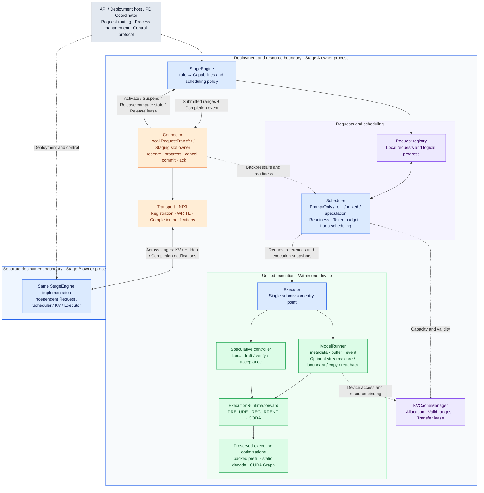
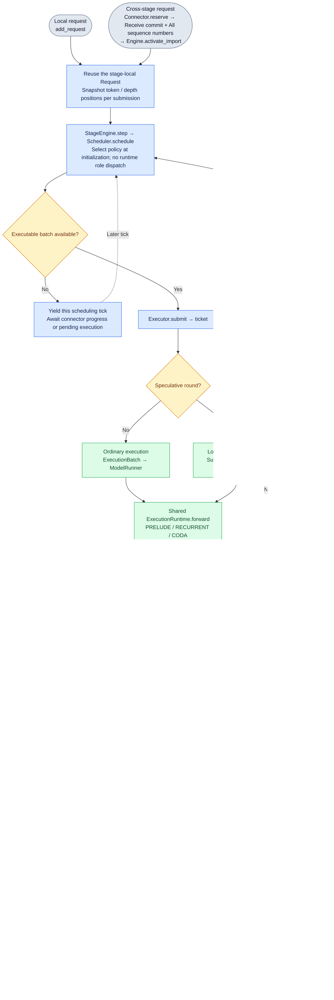
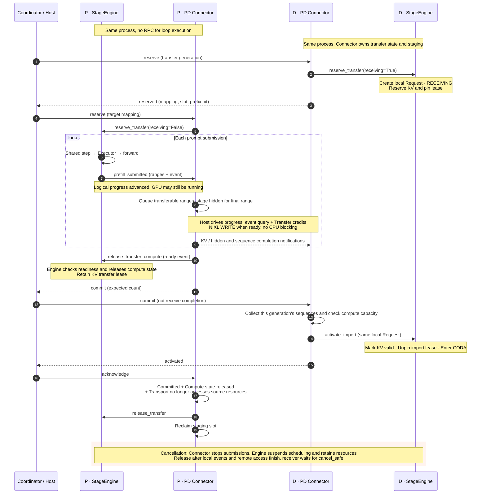

# Stage deployment boundaries and unified execution

**Stage is the deployment and resource boundary; loop is the unit of execution
and scheduling within a stage.**

This guide describes the current implementation. Open the
[offline diagram viewer](diagrams/index.html) without a network connection or
Mermaid plugin, or view the [architecture](diagrams/stage-architecture.svg),
[execution flow](diagrams/unified-forward.svg) and
[PD handoff sequence](diagrams/pd-handoff.svg) as SVGs. Each diagram also has a
PNG export and editable `.mmd` source. Markdown viewers that support Mermaid
render the diagrams below directly.

## 1. Architecture: the same StageEngine in every deployment stage



`StageConfig.role` defines the work a deployment accepts, not the operation of
a particular forward call. `SchedulerConfig.mode` independently selects the
scheduling policy within that stage. Initialization derives `accepts_prompt`
and `produces_tokens` capabilities and selects PromptOnlyPolicy or the existing
refill, mixed or speculative policy. The shared `_schedule` path calls
`Scheduler.schedule`; it does not dispatch by deployment role.

The scheduler checks decode admission, and the readiness contract checks
explicit routing for prompt-only requests. Every stage uses `submit`;
submissions with no host output do not add result readback. For example, a
mixed deployment role may use refill, mixed batching or local speculation.
Speculation does not create a deployment stage: draft and verification stay
within the local controller and GPU.

**Request routing determines communication.** `connector.exports(request)`
indicates that a request's prompt result must go downstream. A mixed stage can
retain local requests while exporting others. Attaching a connector does not
export every request, and a mixed role does not prohibit exports.

The PD launcher still starts P and D processes, each using the same StageEngine.
The single-stage API instantiates StageEngine in the caller's owner process;
`LLMEngine` is a compatibility alias. There is no arbitrary-topology launcher,
and scheduling a loop does not start or switch a process.

## 2. Execution flow: unified submission and logical progress



All execution enters through `Executor.submit(batch)` and returns a ticket.
There is no public `execute` entry point. `async_scheduling` controls collection
timing rather than selecting another execution interface. Without pipelining,
only tickets with host results need `collect()`. With pipelining, tickets are
retained and collected according to dependencies while later work is submitted.
Prefill and loop submissions without host results do not force a GPU wait to
advance logical progress; events enforce device dependencies.

Ordinary speculation submits draft and verification in `submit()` and performs
acceptance in `collect()`. Asynchronous speculation retains device-side
acceptance and its two-round buffer pipeline. Ordinary, mixed and prompt-only
requests advance through `_apply_prefill_progress`, which delegates split
prefill to `_apply_split_prefill_progress`.

An atomic prefill ExecutionBatch contains PRELUDE plus N loops, with hidden
states staying on device. A split prefill RECURRENT submission may return
control to the scheduler; that does not imply exporting data. Chunk size,
loop submission boundaries and stage communication boundaries are independent.

## 3. PD handoff and resource lifetimes



Commit proves that submission has ended, not that reception has completed.
The PD protocol uses a distinct transfer ID as its generation and a set of
sequence numbers to prevent stale messages from activating a new request.

Cancellation first stops new submissions. Resources become reusable only after
remote writes and local hidden-state staging copies finish. The cancellation
path checks `last_event.query()` so a completed model event cannot cause early
reuse while a staging copy is still running. Compute or transport failures
retain the lease; the deployment owner follows the PD failure protocol to stop
the remote writer before reclaiming receiving resources.

## 4. File responsibilities and review order

Paths below are relative to `vllm_rlt/`.

| File | Responsibility |
| --- | --- |
| `engine/stage_config.py` | Deployment identity and accepts_prompt / produces_tokens capabilities; no loop progress |
| `engine/stage_engine.py` | Stage resource owner; request creation, scheduling, submission and logical result application |
| `engine/llm_engine.py` | Compatibility API name without duplicate execution logic |
| `core/scheduler.py` | Local Request registry, queues, budgets, ScheduledRequest snapshots and readiness |
| `core/scheduling_policy.py` | PromptOnly/refill/mixed/speculative policy selection and fairness |
| `worker/executor.py` | Stage submission entry point; ordinary batch binding and speculative round dispatch |
| `core/execution.py` | ExecutionBatch/StateSpan: immutable operation, position and depth bindings |
| `worker/model_runner.py` | Metadata, streams, buffers, hidden/KV access, events and submission tickets |
| `worker/execution.py` | Shared PRELUDE/RECURRENT/CODA model forward |
| `worker/speculative.py` / `async_speculative.py` | Local draft, verification, acceptance and device state |
| `engine/connector.py` | StageConnector execution notifications; TransferConnector progress/cancel/commit/ack lifetime contract |
| `pd/connector.py` | RequestTransfer, staging slots, reservation and handoff protocol ownership |
| `pd/transport.py` | NIXL connections, registration, transfers and completion notifications |
| `pd/worker.py` | Process resources, control messages, connector.progress, shared engine.step and output delivery |
| `pd/engine.py` | Coordinator: process/request routing, reservations, cancellation and failure ordering |

Start with `StageEngine._schedule`, then `Executor.submit`, `ModelRunner.submit`
and `ExecutionRuntime.forward`. Return to `StageEngine._update` and
`_apply_prefill_progress` to review progress application.

`ScheduledRequest` is not a second request lifecycle. It references the local
Request and snapshots the selected token range, depth and phase. ExecutionBatch
converts those references into operation bindings without reconstructing Request
or preparing KV metadata; ModelRunner prepares metadata once. The snapshot is
necessary because `Request.loops_done` can advance after submission while the
submitted KV addresses must remain fixed. `ScheduledWork`, `ExecutionPlan`,
`StageWorkers` and `worker_stage` dispatch have been removed.

`request.Stage` retains existing lifecycle phase names such as
PREFILLING_RECURRENT and CODA. It does not identify a process or create a
worker; StageConfig defines deployment identity.

### Handoff interfaces and state ownership

| State | Owner | Cross-module operations and release conditions |
| --- | --- | --- |
| Local Request, execution progress and queues | StageEngine / Scheduler | Connector calls `suspend_transfer` rather than modifying queues |
| Hidden states, runner slots and events | StageEngine / ModelRunner | `release_transfer_compute(request, ready_event=...)` checks identity and final staging event; returns False until ready |
| KV allocation, validity and transfer lease | StageEngine / KVCacheManager | `activate_import` after all sequences arrive; `release_transfer` after remote access ends |
| RequestTransfer, sequence numbers, commit/ack and staging slots | PDStageConnector | `reserve` once, nonblocking `progress`, reclaim slots after completion |
| NIXL registrations, handles and notifications | NixlConnector | `submit` / `poll` / `busy` report transport state |
| Processes, control channels and failure ordering | PDWorker / Coordinator | Host relays control; stop writers before reclaiming receiver resources |

StageConnector is a lightweight execution-notification interface. Implementations
that transfer across processes also implement the TransferConnector lifetime
contract. `PDStageConnector.reserve` defines PD prompt reservation arguments;
NIXL target mappings do not enter the shared forward interface. Imports currently
hand off a complete prompt into CODA, not arbitrary intermediate loop states.

PDWorker has no duplicate transfer registry and does not manipulate
Request.hidden_state, scheduler queues or ModelRunner.release directly. The
connector uses each RequestTransfer.outgoing flag to select direction, allowing
imports and exports in one mixed stage to share the protocol. Launcher topology
support is unchanged. Engine capacity checks count local compute requests as
well as imports to prevent excess activation.

Missing executable prefill queues are no longer unconditionally treated as
communication waits. Early acknowledgments cannot bypass commit, compute
release or transport completion. Normal transfer direction, chunk timing and
nonblocking progress remain unchanged.

## 5. Performance constraints

- The former StageWorkers._receive global synchronization is removed.
  Connectors use query / wait_event; normal submissions add no host synchronize.
  Readback, bounded buffer reuse, preemption, error cleanup and shutdown may
  still wait. This is not a claim that all synchronization has been eliminated.
- Packed prefill, static buffers, graph replay, homogeneous chunk segments and
  mixed gathering retain their physical paths. The shared contracts concern
  operations and resource ownership.
- Atomic PRELUDE plus N loops and draft/verify stay inside the current executor.
  Internal loops do not become RPCs.
- Scheduling without a connector does not scan communication state. Connected
  requests use readiness checks without rebuilding Request.
- Backpressure participates in queue and batch selection, so a nonempty but
  blocked prompt queue cannot prevent local decode from running.

## 6. Validation history and limitations

The initial refactor replaced role-specific workers sharing a scheduler with
stage resource ownership, merged PD's separate prefill progress loop, moved
transfer preparation into the connector, and made exports request-specific.
Tests cover readiness under backpressure, hidden-staging cancellation lifetimes
and numerical comparisons for imports into independent resources.

CPU coverage includes atomic/split and sync/async paths, mixed local/exported
requests, generations, cancellation, failure lease retention and speculation.
CPU simulated transfers do not establish NIXL/CUDA cross-process correctness.
Real-model GPU smoke tests and three PD GPU handoff/cancellation tests are
recorded in the workspace reports `experiments/stage-refactor-smoke-20261015`
and `experiments/stage-refactor-extended-20261015`. These short runs do not
establish steady-state capacity or qualify every feature combination.

The initial CPU regression run passed **594 tests, with 176 skipped**; Ruff and
`git diff --check` passed. Full collection encountered an existing `lm_eval`
dependency conflict importing `transformers.AutoModelForVision2Seq`, affecting
two GSM8K modules. The regression command excluded them:

```bash
pytest -q --disable-warnings --tb=short \
  --ignore=tests/test_gsm8k_accuracy.py \
  --ignore=tests/test_gsm8k_backends.py
```

CPU counts and GPU handoff/performance evidence are separate. The PD launcher
does not yet accept speculation, mixed batching does not accept speculative
verification rows, and arbitrary intermediate loop migration is not implemented.
These are current support limits, not requirements of the unified engine.

### Ownership-boundary validation

The subsequent CPU regression passed **606 tests, with 176 skipped**, excluding
the same two modules. Six real dual-GPU tests covered handoff, cancellation,
graphs and request reuse; handoff/cancellation were repeated after the final
capacity-wait change. New tests cover out-of-order commit/completion, import
capacity, early acknowledgment, cancellation during hidden copies, stale
notifications, bidirectional mixed handoff and Request identity during release.

Two rounds of real-model smoke tests matched baseline outputs. Asynchronous
speculation was approximately 2–3% slower, with substantial mixed/PD timing
variation. Those runs neither establish no regression nor attribute the
variation to the refactor. Configuration, raw data and source snapshots are in
`experiments/stage-boundaries-20261015/report.md` in the workspace. That boundary
change did not modify model forward, kernels, speculative controllers or graph
execution paths; this alone is not performance attribution.

### Submit-only interface validation (2026-10-15)

Public execute entry points were removed from Executor, ModelRunner and
SpeculativeRunner; the asynchronous speculative controller also uses submit.
Collection follows dependencies rather than waiting immediately after every
submission.

Ouro-1.4B on B300 was warmed up twice and measured three times per version.
Median throughput changes were −0.52% for ordinary non-pipelined decode,
+0.20% for ordinary speculation, +0.85% for asynchronous speculation, +0.44%
for mixed batching at concurrency 32, and −1.16% for split PD. Tokens and exit
depths matched in all five groups. These short runs check obvious regressions;
they do not establish stable speedups. Both PD versions logged the existing UCX
CUDA-context shutdown error and exited with code 0. Raw results and reproduction
scripts are in the workspace `experiments/submit-only-20261015/` directory.

### Optional CUDA multi-stream execution

`ExecutionConfig.multi_stream` independently controls CUDA multi-stream
execution; CLI `--single-stream` disables it. `async_scheduling` controls early
CPU submission and deferred result collection.

| Work | Multi-stream enabled | Multi-stream disabled |
| --- | --- | --- |
| Standalone prelude, including chunk prelude | boundary stream | Shared compute stream |
| Recurrent, including chunk and mixed recurrent | core stream | Shared compute stream |
| Coda | boundary stream | Shared compute stream |
| Routing / speculative result copies | copy stream | Shared compute stream |
| Ordinary token/gate readback | readback stream | Shared compute stream |

Full prefill's prelude plus N loops remains one continuous submission on the
core stream. Draft/verify within a speculative round also stays continuous.
Speculative controllers reuse worker streams instead of creating another set.
Ordinary boundary operations retain their boundary stream.

Chunk dependencies are established before `prepare_batch`, because hidden
gather reads state written by the preceding submission. Ordinary async batches
retain early CPU metadata preparation and wait for producers before computation.
Completion events protect metadata buffers; request-specific dependencies avoid
replacing stream events with global synchronization.

Ordinary submissions record compute completion separately from readback
completion. Request device dependencies, routing and chunk metadata reuse wait
for compute; ticket `ready()` / `collect()` wait for readback. Independent
sampled-token and sigmoid-result tensors supply readback. `record_stream`
protects them if a ticket is canceled or discarded, without borrowing graph
outputs that later execution will overwrite. Single-stream mode keeps these
operations ordered on the same stream.

Entire batches skip gate readback when async fixed-depth execution, tracing or
the maximum loop boundary leaves no gate consumer. CUDA Graph computation
remains unchanged. Mixed batches with some consuming rows retain their original
index layout without sparse remapping. Routing/readback pools prefer completed
buffers and wait only when all are busy. Page-table updates reuse pinned buffers
and upload changed ranges. Prelude/coda routing generates only slot mappings,
not recurrent-attention page tables.

Chunk and mixed inputs reuse the `PrefillMetadataBuffers` pool. CPU writes are
allowed only after the final consumer event; completed entries are preferred.
Source tensor references remain alive while the GPU reads them. Request prompts
are filled once in the pinned row for their runner state slot; subsequent chunks
submit range descriptions. On NVIDIA CUDA, Triton reads pinned descriptions and
prompts directly into the final GPU token batch, avoiding repeated CPU prompt
concatenation and separate metadata H2D copies. Explicit `input_tokens` still
overrides request input. Cancellation, completion and preemption release slots
and prompt ownership after the existing completion events, preventing stale
inputs when IDs or slots are reused.

Mixed recurrent chunk/decode hidden states already reside on GPU. Triton uses
pinned source addresses, strides, row counts and destination ranges to populate
a reusable hidden batch and scatter results back to chunk and final hidden
states, replacing per-request `torch.cat` / GPU `copy_`. Necessary hidden-state
reordering remains. Ordinary decode retains its separate static-buffer/CUDA
Graph path. CPU uses tensor operations; HIP uses device metadata copies without
requiring UVA.

A mixed deployment stage can use speculation, but scheduling `mode="mixed"`
cannot currently combine with speculation. That combination needs scheduling
budgets, verification input organization and acceptance/rollback support;
it is independent of the multi-stream toggle.

Multi-stream routing validation passed 229 GPU tests with 2 skipped, plus 89
Huginn/speculation tests with 1 skipped. After dependency placement changed,
104 chunk/async pipeline/async speculation tests passed. CPU regression passed
610 tests with 182 skipped. Delayed chunk-prelude tests cover single/multi-stream
and sync/async combinations, checking gathered hidden states against producers.

The initial short performance comparison did not establish no regression:
relative to the reverse-order baseline medians, ordinary non-pipelined decode
was about −2.3%, async speculation −0.3%, and mixed concurrency 32 −6.3%, with
matching tokens/depths. An earlier single-stream comparison also showed mixed
slowdown, so stream switching alone could not explain it. PD timing varied too
much for a speedup conclusion. Raw data and reproduction scripts are in the
workspace `experiments/streams-feature-20261015/` directory. These are historical
short-run observations, not a claim of a stable regression.
